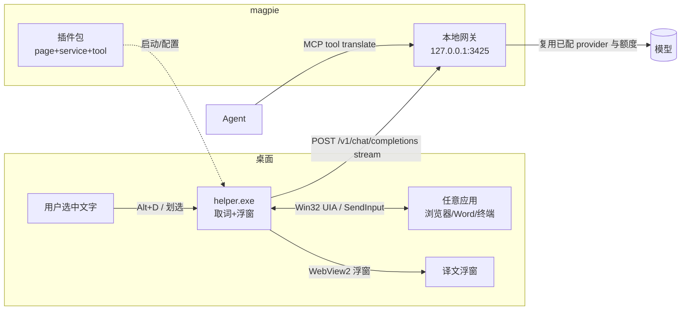

# 墨鸢划词翻译 · 技术方案（magpie 插件）

> 目标：在任意应用里选中一段文字，立刻在光标旁弹出浮窗，用 magpie 网关的模型实时翻译（中↔英 + 其他语言）。
> 仓库：`yetone/magpie`（MIT，Go + Bun 插件宿主）· 本地网关 `http://127.0.0.1:3425`

---

## 0. 结论先说

| 问题 | 结论 |
|---|---|
| 能不能做成"纯 magpie 插件"（只写 npm 包，不装别的）？ | **不能。** 插件体系里没有全局热键、读系统选区、鼠标钩子、桌面浮窗这四类能力，页面只能活在 magpie 自己的窗口里。 |
| 那要怎么做？ | **两层结构**：① magpie 插件包（壳，负责安装/设置页/状态/给 agent 的工具）；② 常驻 helper 进程（真正干活：取词 + 浮窗 + 调网关）。 |
| 翻译调什么？ | 直接用 magpie 网关的 `POST /v1/chat/completions`（OpenAI 兼容、流式）。复用它已配好的 provider / 额度 / 故障转移，**不需要任何 API key**。 |
| 最小可行版本多大？ | 取词 1 个函数 + 浮窗 1 个 WebView + 1 次 fetch，约 800~1200 行 Go + 100 行 JS/HTML。 |

一句话架构：**选中 → helper 取词 → 本地网关 → 流式回显到浮窗**。插件包只是"帮助用户装上并配置 helper"的那层包装。

---

## 1. 目标与非目标

### 做
1. 划选文本后按键（默认 `Alt+D`，可改）立即翻译；可选"划词即弹"模式。
2. 英→中、中→英自动判定，其他语言（日/韩/俄/法/德…）默认→中文。
3. 浮窗跟随鼠标 / 选区，流式逐字显示，`Esc` 取消，一键复制译文。
4. 在 magpie 里有一个 **设置页**（模型、目标语言、触发方式、术语表、黑名单应用）。
5. 给所有 agent 暴露一个 `translate` MCP 工具（顺手就有，成本几乎为零）。
6. 缓存命中秒出；model/prompt 对前缀缓存友好。

### 不做（第一版）
- 网页内联替换译文（那是浏览器扩展的活）。
- OCR 取图上的文字（截图翻译放第二版）。
- 发音/朗读、术语库管理 UI、多语言批量文档翻译。
- macOS/Linux 首发——先 Windows（用户当前平台），接口按跨平台设计。

---

## 2. 平台能力与硬约束（决定架构的部分）

| 插件能力 | 有 / 无 | 影响 |
|---|---|---|
| `page` 页面 + `service` 后端 | 有 | 设置页、状态面板没问题 |
| `tool` hook → MCP 工具 | 有 | agent 可调 `translate` |
| `actions`（provider/agent 行右键菜单） | 有，但只有这两种位置 | 做不了"全局右键菜单" |
| `panels`（agents/usage/settings/provider 槽位） | 有 | 可插一个小面板显示"总开关/今日字数" |
| 全局热键 / 读剪贴板 / 读选区 / 鼠标钩子 / 托盘 / 桌面浮窗 | **无** | 必须 helper |

**页面（iframe）沙箱约束**（写代码前必须知道）：
- `sandbox="allow-scripts"`，CSP `connect-src 'none'` → fetch/XHR/WebSocket/表单/内联 `<script>` 全禁，**页面内不能发任何请求**。
- 唯一出网动作是 `location.replace(url)`：把整个页面导航到别处。**不要先探测端口**，探测永远失败。
- 必须 10s 内 `await window.magpie.ready`，否则页面被判定失败。
- 页面文件由 `/_magpie/plugin/<每次启动都变的 token>/` 提供；用相对路径引用资源。
- 页面可控项：`magpie.options.get/set`（≤1 次/秒）、`magpie.theme/onTheme`、`magpie.read(...)`、`magpie.onAction`、`magpie.service`。
- `magpie web` 模式下 `magpie.service` 是本服务在 magpie 地址上的转发前缀，**优先用它**，其次才走 `http://127.0.0.1:<port>`。

**宿主稳定性坑**：所有插件共用一个 Bun plugin host；别的插件登录失败会拖住它，页面迟迟不加载、`server` 不启动。→ helper **必须能独立自启**（计划任务 / 启动文件夹），不能依赖 plugin host 活着。

**Windows 侧坑**：`.cmd` / `.vbs` 必须 CRLF；多显示器 DPI 要用 `GetDpiForWindow` + 物理像素坐标；Electron 应用默认不暴露 UIA 文本（见 §4.2）；`Ctrl+C` 兜底会短暂占用剪贴板，必须 try/finally 还原。

---

## 3. 总体架构



### 组件职责

| 组件 | 语言 | 职责 | 不负责 |
|---|---|---|---|
| `magpie-select-translate`（插件包） | JS/ESM | 安装、`options` 落盘、设置页、启动/探测 helper、注册 `translate` 工具 | 取词、浮窗 |
| `helper.exe` | Go（Win32 + WebView2） | 全局热键、鼠标监听、UIA 取词、剪贴板兜底、浮窗、调网关、缓存 | magpie 内部状态 |
| magpie 网关 | — | 模型调用、额度、故障转移 | — |

---

## 4. 取词方案（核心难点）

### 4.1 方案对比

| 方案 | 优点 | 缺点 | 采不采 |
|---|---|---|---|
| **UI Automation `TextPattern.GetSelection()`** | 不碰剪贴板、准、支持浏览器/Office/WPF | Electron/部分 app 无文本模式；个别 app 会卡 200ms+ | ✅ 首选 |
| **模拟 `Ctrl+C` + 读剪贴板** | 通吃所有能复制的 app | 污染剪贴板、终端里 Ctrl+C 是中断、可能弹权限 | ✅ 兜底 |
| `WH_MOUSE_LL` 低层鼠标钩子 | 能知道"拖选结束" | 只能判断位置，拿不到文字，仍需上面两种 | ✅ 仅作触发 |
| 浏览器扩展 | 取词最准 | 只覆盖浏览器，且要另发一个扩展 | ❌ |
| 截图 + OCR | 覆盖图片/视频 | 慢、贵、错字 | ❌ 二期 |

### 4.2 取词流程（伪代码）

```
onTrigger(mousePoint):
  win = WindowFromPoint(pt)
  if inBlacklist(win.processName): return
  text = UiaGetSelection(win, pt)          # 见下
  if empty(text): text = ClipboardGetSelection(win)   # 兜底
  if empty(text) or len>5000: return HUD("没取到文字")
  translate(text)

UiaGetSelection:
  el = ElementFromPoint(pt)                # IUIAutomation::ElementFromPoint
  walk up maxdepth=6:
    if el supports TextPattern:  rng = GetSelection(); return rng.GetText()
    if el supports ValuePattern and isEditable: return value/selected
  return ""

ClipboardGetSelection:
  saved = readClipboardAll()               # 保留文本/图片/HTML，尽量全量
  send Ctrl+C; sleep 120ms; txt = readText()
  restore(saved)                           # 必须在 defer/finally 里
  return txt
```

细节：
- **UIA 超时要设**：`IUIAutomation` 的 `ConnectionTimeout`/跨进程调用在 app 无响应时会挂住 → 在 goroutine 里跑，`250ms` 超时后直接降级到剪贴板法。
- **去重**：同文本 1s 内只翻一次（hash + 时间戳）。
- **最小长度**：<2 字符不翻（避免误触）。
- **划选即弹**：`WH_MOUSE_LL` 监听 `WM_LBUTTONUP`，若 `UP-DOWN` 位移 > 4px 且间隔 <1.5s → 视为划选；伤害面大，**默认关闭**，只作可选开关。
- **黑名单默认值**：`mstsc.exe`（远程桌面）、`WindowsTerminal.exe`/`conhost.exe`（Ctrl+C 危险，只允许 UIA）、密码管理器、游戏全屏。

### 4.3 浮窗

用 **WebView2**（Win11 自带运行时，`webview_go` 绑定）加载本地 HTML，而不是自绘文本：
- 省掉文本排版/选中/复制/字体缩放的一堆 Win32 手工活；
- 流式增量更新就是一次 `postMessage` / `window.chrome.webview.postMessage`；
- 窗口样式：`WS_POPUP + WS_EX_NOACTIVATE + WS_EX_TOOLWINDOW + WS_EX_TOPMOST`，分层窗口透明背景，圆角阴影由 CSS 画；
- 定位：光标 `(x+16, y+20)`，超出工作区则翻到上方/内侧；用 `MonitorFromPoint` 取该屏 work area，按 `GetDpiForWindow` 缩放；
- 交互：`Esc` 关闭、`Ctrl+C` 复制译文、滚轮滚长文；`WS_EX_NOACTIVATE` 保证不抢焦点（不打断用户正在打的字）。

---

## 5. 翻译链路

### 5.1 请求

复用 `@magpie-community/page-chat` 的网关发现逻辑（已在本机验证可用，源码在 `Temp\opencode\magpie-docs\chat\lib\gateway.mjs`）：

1. 候选地址：`options.gateway` → `MAGPIE_ADDR` → 读 `~/.config/magpie/settings.json`（或便携版 `<magpie>/data/settings.json`）里的 `port` → `http://127.0.0.1:3425`；
2. 用 `GET /v1/models`（2.5s 超时）探测，选中后缓存 60s；
3. 鉴权：`MAGPIE_API_KEY` / `MAGPIE_GATEWAY_KEY` → 否则读 `caller-keys.json` 任一 `secret`；桌面版通常不需要；
4. 请求：`POST {base}/v1/chat/completions`，`{model, messages, stream:true, temperature:0}`。

模型选择顺序：`options.model`（用户在设置页选的 `provider/model`）→ `/v1/models` 里第一个可用 → 报错提示去 magpie 里配一个 provider。

### 5.2 Prompt（前缀缓存友好）

system 必须**逐字节稳定**（用户的 magpie 走真前缀缓存，system 里拼时间戳/字数会直接掉命中）：

```
You are a translation engine. Translate the text the user sends into {{TARGET}}.
Rules:
- Output only the translation, no explanations, no quotes, no "Translation:" prefix.
- Preserve Markdown, code blocks, inline code, URLs, emails and placeholders ({{}}, %s, {0}) exactly.
- Keep proper nouns and product names; keep numbers and units.
- If the text is already in {{TARGET}}, translate it into {{SOURCE_FALLBACK}} instead.
```

- `{{TARGET}}` 只有 `zh-CN` / `English` 等少数取值 → 前缀命中率高。
- 术语表、上下文、`请保留换行`等**全部放 user 消息尾部**，别动 system。
- 长文本按段落切（保留 Markdown 结构）或直接整段发（≤4000 字符），流式回显时按 `\n\n` 段落渐进显示。

### 5.3 语言判定（本地，先判后翻）

```
hasCJK   = /[\u4e00-\u9fff\u3400-\u4dbf]/
hasKana  = /[\u3040-\u30ff]/
hasHangul= /[\uac00-\ud7af]/
hasCyr   = /[\u0400-\u04ff]/
hasLatin = /[A-Za-z]/
```
- 命中 CJK 且不含拉丁字母 → 目标 `English`；
- 命中 Kana → 目标 `zh-CN`；Hangul → `zh-CN`；Cyrillic → `zh-CN`；
- 纯拉丁 → `zh-CN`；
- 其余/混合 → 用 `options.defaultTarget`；
- 用户可强制 `en↔zh` 固定模式（设置页开关）。

> 不做语言检测模型，正则够用且零延迟。

### 5.4 缓存与性能目标

- LRU 512 条，key = `sha1(text + target + model)`，进程内不落盘（隐私：默认不写日志原文）。
- 指标：热键到首字 < 600ms（云模型）/ 命中缓存 < 50ms。
- 流式超时 55s（MCP 工具侧同为 55s）；用 `AbortController` 让新请求打断旧请求。

### 5.5 错误处理（用户看得见的）

| 情况 | 浮窗显示 |
|---|---|
| 网关连不上 | `magpie 未运行` + `重试` |
| 模型 401/404 | `模型不可用，请在 magpie → Agents 里选一个` |
| 流中断 | 已收到的译文保留 + 末尾 `…(中断，点击重试)` |
| 文本过长 | `文本超过 5000 字，已截断` |

---

## 6. 插件包设计

### 6.1 目录

```
magpie-select-translate/
├─ package.json
├─ index.mjs                 # 插件入口：启动/探测 helper
├─ page/
│  ├─ index.html            # 设置页（在 iframe 里跑，不能发请求 → 只读写 options）
│  └─ app.js
├─ bin/
│  └─ magpie-translate-helper.exe   # 可选：随包分发（体积大，或用下载脚本）
└─ README.md
```

### 6.2 `package.json`

```json
{
  "name": "magpie-select-translate",
  "version": "0.1.0",
  "type": "module",
  "main": "./index.mjs",
  "keywords": ["magpie-plugin", "magpie", "translation"],
  "engines": { "magpie": ">=0.1.1340" },
  "magpie": {
    "name": "划词翻译",
    "summary": {
      "zh": "选中即译：任意应用划词，浮窗流式翻译，中英互译 + 多语言。",
      "en": "Select-to-translate anywhere: streaming popover translation via the magpie gateway."
    },
    "page": {
      "title": "Translate",
      "file": "page/index.html",
      "service": { "port": 3477, "option": "port" }
    },
    "options": {
      "port": 3477,
      "model": "",
      "target": "auto",
      "trigger": "hotkey",
      "hotkey": "Alt+D",
      "glossary": ""
    },
    "permissions": ["providers:list"]
  }
}
```
> `titles`（多语言标题）、`icon`（https 或 data URI ≤1MB）、`panels`、`actions` 字段的形状以 `docs/reference.md` 为准，接入时再补。

### 6.3 `index.mjs`

只做三件事：解析 options、拉起 helper（已运行则不拉）、把端口/网关信息写进环境变量。

```js
import { spawn } from "node:child_process"
import { existsSync } from "node:fs"
import { join, dirname } from "node:path"
import { fileURLToPath } from "node:url"

const here = dirname(fileURLToPath(import.meta.url))
const exe = process.env.MAGPIE_TRANSLATE_HELPER || join(here, "bin", "magpie-translate-helper.exe")

async function healthy(port) {
  try {
    const r = await fetch(`http://127.0.0.1:${port}/api/ping`, { signal: AbortSignal.timeout(800) })
    return r.ok
  } catch { return false }
}

export default {
  id: "magpie-select-translate",
  // service 让 magpie 知道这个插件带本地服务；真正的服务由 helper 提供
  server: async (input, options) => {
    const port = Number(options?.port) || 3477
    if (await healthy(port)) return { port }
    if (!existsSync(exe)) return { port, error: "helper 未安装：运行 install.ps1" }
    const child = spawn(exe, ["--port", String(port), "--gateway", process.env.MAGPIE_ADDR || ""], {
      detached: true, stdio: "ignore", windowsHide: true
    })
    child.unref()
    return { port }
  }
}
```
> helper 的 `/api/ping` 是幂等探活，重复 spawn 无害（进程内单实例锁 + 端口占用即认为别人在跑）。

### 6.4 设置页（iframe 内能做什么）

- `await magpie.ready` → `magpie.options.get()` 渲染表单 → 保存走 `magpie.options.set()`（**节流 ≥1s**，别每次按键都写）；
- 模型下拉用 `magpie.read("providers:list")`（需 `permissions`），拿不到就让用户手填 `provider/model`；
- **不能** `fetch` helper 的 `/api/ping` 来做"已连接"指示（CSP 禁止）；要么由 `server` hook 探活后写进 options（如 `lastStart`），要么干脆不显示；
- 想要真实状态（今日译文字数、当前模型、helper 是否活着）→ 用 `panels` 槽位或干脆在 magpie 外做托盘菜单。

降级方案：如果用户不想装 helper，设置页退化为"粘贴框翻译/文本域 + 结果区"，仍能 `magpie.options` + 一次 `location.replace(service)` 跳到 helper 的本地网页版。

### 6.5 给 agent 的 MCP 工具（顺带）

`tool` hook 注册 `translate_text`，工具名会变成 `magpie-select-translate_translate_text`，agent 在 `http://127.0.0.1:3425/mcp/magpie/tools` 里能看到。逻辑就是同一个 HTTP 调用，**不重复实现**。

---

## 7. helper 的本地接口

只监听 `127.0.0.1`，校验 `Host`/`Origin`（挡浏览器 CSRF），启动时生成随机 token 放 `/api/ping` 之外的路径（可选）。

| 方法 | 路径 | 说明 |
|---|---|---|
| GET | `/api/ping` | `{ok:true, version, port, gateway}` |
| POST | `/api/translate` | `{text, target?, model?}` → `text/event-stream`，逐块 `data: {"delta":"…"}` |
| POST | `/api/selection` | 触发一次取词（调试/给页面按钮用） |
| GET/PUT | `/api/settings` | 读/写 helper 侧设置（与 magpie options 互通） |
| GET | `/` | 网页版翻译界面（无插件也能用） |

---

## 8. 配置项（写进 `magpie.options`）

| key | 默认 | 说明 |
|---|---|---|
| `port` | 3477 | helper 端口，3477–3480 自动顺延 |
| `model` | `""` | `provider/model`，空=用网关第一个可用 |
| `target` | `auto` | `auto` / `zh-CN` / `English` / 具体语言 |
| `trigger` | `hotkey` | `hotkey` / `select`（划词即弹） / `both` |
| `hotkey` | `Alt+D` | 全局热键 |
| `glossary` | `""` | 术语表，一行 `原文=译文` |
| `blacklist` | 内置 | 取词黑名单进程名 |
| `maxChars` | 5000 | 超长截断 |

---

## 9. 实施计划

| 阶段 | 内容 | 出口判据 | 估时 |
|---|---|---|---|
| **M0 spike** | 取词验证：UIA 在 Chrome/Edge/Word/VSCode/终端/QQ 各取一次；比剪贴板法准确率 | 目标 app 覆盖 ≥80%，单次 <300ms | 0.5d |
| **M1 骨架** | helper：热键 + 浮窗 + 直连网关流式（写死 prompt） | 划词到出译文端到端可用 | 1d |
| **M2 打磨** | 语言判定、缓存、错误态、黑名单、DPI/多屏、Esc/复制 | 见 §10 验收 | 1d |
| **M3 插件壳** | `package.json` / `index.mjs` / 设置页 / MCP 工具 / 一键安装脚本（PS1 + CRLF 的 .cmd/.vbs 自启） | `magpie plugin add` 后设置页可用，重启后 helper 自起 | 0.5d |
| **M4 发布** | npm 包 + `magpie-plugin` topic + community registry 条目 + README 截图 | 别人能一条命令装上 | 0.5d |

---

## 10. 验收标准

1. Chrome 里选中英文段落 → `Alt+D` → 500ms 内浮窗出现中文，逐字流式；`Esc` 关闭。
2. Word/WPS 选中中文 → 输出英文，**编号/表格/换行不变**。
3. 终端里选中路径（含空格/引号）→ 不误触发 Ctrl+C 中断，UIA 失败时安静降级。
4. 同一段文字连按两次，第二次 <50ms（缓存）。
5. 关掉 magpie 网关 → 浮窗显示"magpie 未运行"，不崩、不卡键。
6. 剪贴板兜底结束后，原剪贴板内容**完好**（文本 + 图片）。
7. 双屏 150% DPI 下浮窗位置正确、不越界。
8. `magpie plugin add <pkg>` → 设置页显示 options，改模型后立即生效。
9. agent 调 `magpie-select-translate_translate_text("hello")` 返回中文。

---

## 11. 风险与对策

| 风险 | 影响 | 对策 |
|---|---|---|
| Electron 应用（VSCode/Slack/QQ）UIA 拿不到选区 | 取词失败 | 降级剪贴板法；关闭时用 `app.setAccessibilitySupportEnabled` 的应用加白名单说明 |
| UIA 跨进程调用挂住 | 界面卡 | 250ms 超时 + goroutine + 降级 |
| Ctrl+C 兜底把用户剪贴板洗了 | 数据丢失 | 全量保存/`defer` 还原；终端类进程禁用该路径 |
| plugin host 被别的插件拖挂 | 设置页打不开 | helper 独立自启，不依赖插件加载 |
| 网关模型返回解释性废话 | 译文里混 "Sure, here is…" | 严格 system + `temperature:0` + 前两行启发式剥离 |
| system prompt 变化破坏前缀缓存 | 变贵变慢 | system 逐字节稳定，变量全部放 user 尾部 |
| GitHub release 下不动 helper 二进制 | 安装失败 | 走镜像（`gh-proxy.com` / `ghfast.top`），并支持离线 zip |
| 隐私：译文/原文出网 | 合规 | 网关是本机、provider 是用户自己配的；默认不落盘、日志只记字数与耗时 |

---

## 12. 发布清单

- [ ] npm `magpie-select-translate`，`keywords: ["magpie-plugin","magpie"]`
- [ ] GitHub 仓库打 `magpie-plugin` topic，release 挂 `helper-windows-amd64.exe` + SHA256
- [ ] community registry 条目：`{"package":"…","name":"划词翻译","kind":"page","community":true,"icon":"…","summary":{"en":"…","zh":"…"}}`
- [ ] README：gif 演示、取词覆盖矩阵、黑名单说明、隐私说明
- [ ] 卸载干净：`magpie plugin rm` + 删自启项 + 删 `%LOCALAPPDATA%\magpie-translate`

---

## 附：为什么不做"纯插件版"

纯插件版只能在 magpie 窗口里粘贴文本翻译，等于把"选中即译"这个核心需求砍掉一半。真正的价值在系统级取词，而 magpie 插件模型刻意不给这个权限（安全边界，合理）。所以本方案把插件定位为 **安装器 + 设置面板 + agent 工具**，把能力放在一个用户可见、可卸载、只连本机的 helper 里——代价是一个 exe，收益是产品真的能"选中就翻译"。
